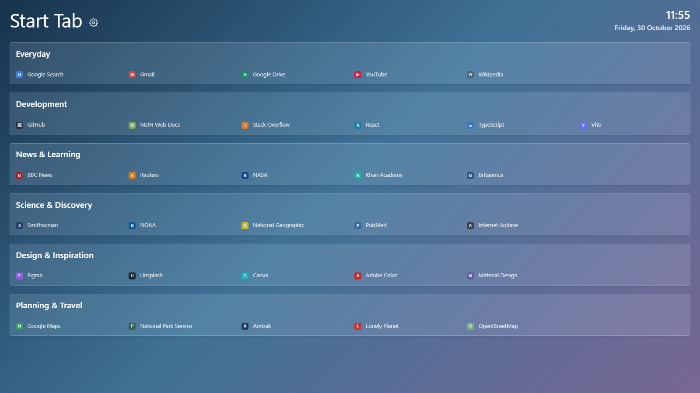

# Start Tab

Start Tab turns your new tab into a calm, useful launchpad for the sites you visit most. Your bookmarks stay organized and within reach, the clock keeps you on track, and a customizable background makes the page feel like yours.

## A new start tab, your way

- **Your bookmarks, organized.** Browse links by folder, then drag them into the order that works for you. Changes are saved directly to your browser bookmarks.
- **Time at a glance.** See the current time and date, or switch the clock off in Settings.
- **Make it yours.** Choose a two-colour gradient or use your own background image. Your background choice is stored locally.
- **Ready whenever you are.** Start Tab runs as a local extension, works offline after installation, and requires no account.

## Install

- [Google Chrome](https://chrome.google.com/webstore/detail/start-tab/dcfkennngcocepafgnfagnbjjmfobgbm)

- [Microsoft Edge](https://microsoftedge.microsoft.com/addons/detail/start-tab/agcgbbneiplcaaioicimencggglchbii)

## Changes

## 1.3.0
- Updated project dependencies
- Migrated the build tooling from Parcel to Vite
- Added settings to toggle the clock and choose a custom background
- Added drag-and-drop bookmark reordering and folder moves

## 1.2.0
- Updated manifest to V3

## 1.1.0
- Added support for dark-theme

## 1.0.3
- Added Google Chrome support

## 1.0.0
- Real time clock
- Bookmark list organised by folder
- Initial support for Edge
